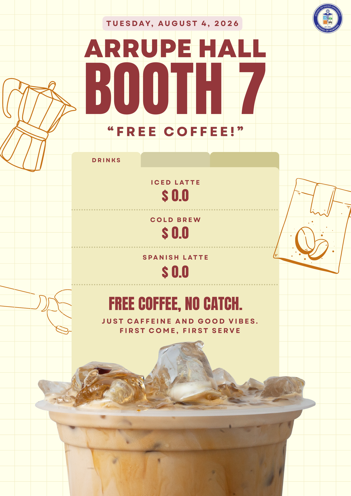

# ☕ Presentation Design Principles

> *A good design doesn't just look good — it communicates.*

## 📌 Activity Description

This activity involved creating a promotional flyer for a free coffee booth at Arrupe Hall, Booth 7. The design was created to communicate the event details, available drinks, and promotional message in an attractive and easy-to-understand way. Through the use of visual elements, typography, colors, imagery, and layout, the flyer was designed to capture attention and communicate information effectively.

## 🎨 My Output

Free Coffee · Arrupe Hall · Booth 7

---

## ✦ What I Learned

- I learned that **visual hierarchy** helps guide the audience toward the most important information first, such as the booth number, promotional message, and available drinks.
- I learned how **contrast, typography, spacing, and alignment** work together to make a design more readable, organized, and visually appealing.
- One challenge was balancing the different elements of the flyer without making it feel overcrowded. I addressed this by organizing the information into sections and making the main message more prominent.
- I realized that images and illustrations can support a message when they are used intentionally instead of simply being decorative.
- In the future, I can apply these principles to posters, presentations, infographics, digital advertisements, and other visual communication projects.

---

## 🛠 Concepts Applied

`Visual Hierarchy` · `Contrast` · `Typography` · `Alignment` · `Whitespace` · `Imagery`

---

*Design with purpose. Communicate with clarity.*

