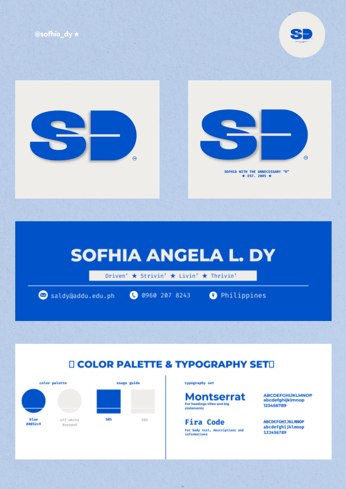

# 🎨 Color Palette & Typography

> *Every color, font, and shape tells a story.*

## 📌 Activity Description

This activity focused on developing a personal visual identity through the creation of a color palette, typography system, and personal logo. The design was centered around my initials, "SD," using blue and off-white as the primary colors. The goal was to establish a consistent and recognizable visual identity that reflects simplicity, creativity, and a modern digital aesthetic.

## 🎨 My Output

SD · Personal Brand Identity

---

## ✦ What I Learned

- I learned how **color choices influence the mood and perception** of a design. Blue can communicate trust and professionalism, while off-white creates a softer and cleaner visual appearance.
- I learned that typography is not only about choosing a font but also about establishing hierarchy, readability, and consistency throughout a design.
- One challenge was selecting colors and fonts that complement each other while maintaining a recognizable personal identity. I addressed this by using a limited color palette and pairing fonts with different but complementary characteristics.
- I realized that branding requires consistency across different materials, including logos, business cards, headers, and digital portfolios.
- In the future, I can apply these branding principles to website development, presentation design, marketing materials, and other creative projects.

---

## 🟦 My Color Palette

| Color | Hex Code | Purpose |
|---|---|---|
| Blue | `#0052C9` | Main brand color |
| Off-White | `#EEEDE9` | Background and balance |

## ✍️ Typography

**Montserrat** — used for bold headings, important text, and visual statements.

**Fira Code** — used for technical details and text with a digital aesthetic.

---

## 🛠 Concepts Applied

`Brand Identity` · `Color Theory` · `Typography` · `Visual Consistency` · `Logo Design`

---

*Consistency creates identity. Creativity makes it memorable.*

