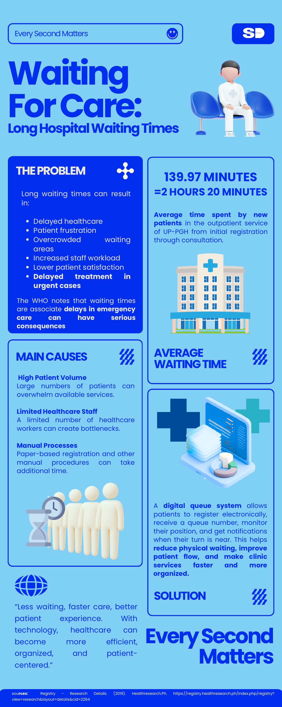

# 🩺 Waiting for Care

> *Every second matters.*

## 📌 Activity Description

This activity involved creating an infographic about long hospital waiting times and their possible effects on healthcare delivery and patient experience. The infographic presents the problem, contributing factors, and the proposed use of a digital queue management system called MediQueue. The project combines visual communication, healthcare-related information, and a technology-based concept to illustrate how digital solutions may improve patient flow and organization.

## 🎨 My Output

Waiting for Care · Long Hospital Waiting Times

---

## ✦ What I Learned

- I learned how infographics can simplify information and make complex or lengthy topics easier for audiences to understand through visual presentation.
- I learned how to organize information into sections such as the problem, causes, relevant data, and proposed solution while maintaining visual hierarchy and readability.
- One challenge was presenting healthcare-related information in a visually engaging format without overwhelming the audience. I addressed this by organizing the content, using visual illustrations, and emphasizing the most important information.
- I learned that technology can be explored as a possible solution to operational problems in healthcare, such as patient queue management, appointment scheduling, and communication.
- In the future, I can apply infographic design, research organization, and problem-solving skills to nursing education, patient education materials, healthcare presentations, and digital health projects.

---

## 🔎 The Problem

Long hospital waiting times may contribute to:

- Delayed healthcare
- Patient frustration
- Overcrowded waiting areas
- Increased staff workload
- Reduced patient satisfaction

## 💡 Proposed Solution: MediQueue

MediQueue is a conceptual digital queue management system designed to improve patient flow through features such as:

- Online booking
- QR-code check-in
- Queue-number monitoring
- Notifications
- Digital scheduling and organization

---

## 🛠 Concepts Applied

`Infographic Design` · `Information Hierarchy` · `Research` · `Problem Solving` · `Healthcare Technology`

---

*Less waiting. Faster care. Better patient experience.*

