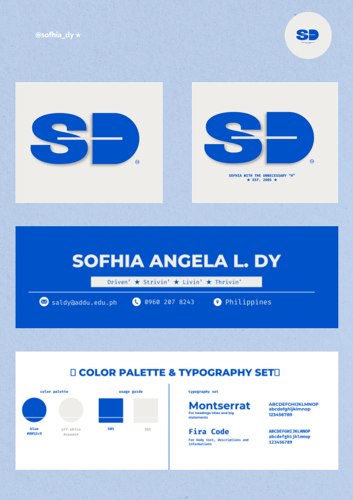

 

---

# ♡ ABOUT ME

<table>
<tr>
<td align="center" width="50%">

</td>
<td align="center" width="50%">

</td>
</tr>
</table>

# SOFHIA ANGELA L. DY

**SENIOR NURSING STUDENT**  
*Bachelor of Science in Nursing*

Hi! I'm **Sofhia Angela L. Dy**, a Senior Nursing Student pursuing a Bachelor of Science in Nursing at Ateneo de Davao University. This digital portfolio showcases my journey through **GE 4120: 21st Century IT Skills**, where I explored creativity, digital tools, presentation design, artificial intelligence, website development, and visual communication.

Outside academics, I enjoy **playing pickleball**, exploring creative ideas, discovering new things, and trying different experiences. I enjoy learning, experimenting, and finding ways to make ideas more interesting and meaningful.

### ♡ A LITTLE MORE ABOUT ME

---

# ✦ PORTFOLIO OVERVIEW

This portfolio contains seven activities that represent my learning journey in GE 4120. From presentation design and branding to AI-assisted creation and website development, each activity allowed me to explore how digital technology can be used to communicate ideas, solve problems, and create meaningful outputs.

---

# ☕ ACTIVITY 1
## Presentation Design Principles

<text color="#0052C9" weight="semibold">PROMOTIONAL FLYER · ARRUPE HALL · BOOTH 7</text>

A promotional flyer for a free coffee booth featuring iced latte, cold brew, and Spanish latte. This activity focused on applying presentation design principles such as contrast, visual hierarchy, alignment, typography, whitespace, and imagery.

**What I explored:**

- Visual hierarchy
- Typography
- Contrast
- Layout and alignment
- Creative presentation design

---

# 🎨 ACTIVITY 2
## Color Palette & Typography

<text color="#0052C9" weight="semibold">PERSONAL BRANDING · SD BRAND IDENTITY</text>

A personal brand identity centered around my initials, SD. This project included a logo, business card concept, color palette, and typography guide that demonstrated the importance of consistency and visual identity.

**What I explored:**

- Color theory
- Typography pairing
- Brand identity
- Logo design
- Design consistency

---

# 🩺 ACTIVITY 3
## Infographic & Mini Project Documentation

<text color="#0052C9" weight="semibold">HEALTHCARE INFORMATION DESIGN · MEDIQUEUE</text>

An infographic exploring long hospital waiting times and their effects on healthcare delivery, paired with a project proposal for MediQueue, an IT-enabled patient queuing system. This activity combined research, information design, healthcare problem-solving, and technology.

**What I explored:**

- Visual storytelling
- Data and information presentation
- Research
- Healthcare technology
- Digital problem-solving

---

# 💻 ACTIVITY 4
## Preliminary Examination

<text color="#0052C9" weight="semibold">DIGITAL APPLICATION · COURSE EXAMINATION</text>

A project demonstrating the application of digital skills, creativity, organization, and concepts learned throughout the course. This activity represents the use of technology and digital tools to complete and present an academic output.

**What I explored:**

- Digital tools
- Creative application
- Presentation
- Project organization

---

# ☕ ACTIVITY 5
## Kapeng Umaga vs. Maison Miel

<text color="#0052C9" weight="semibold">AI-ASSISTED WEBSITE DESIGN · COMPARATIVE ANALYSIS</text>

A comparison of AI-generated website concepts for Kapeng Umaga and Maison Miel. This activity explored how prompts, instructions, branding, and design requirements influence the results generated by AI tools.

**What I explored:**

- Prompt engineering
- AI-assisted design
- Website concepts
- Comparative evaluation
- Creative direction

---

# 🧵 ACTIVITY 6
## Likha Leather Works

<text color="#0052C9" weight="semibold">WEBSITE CONCEPT · DIGITAL ENTREPRENEURSHIP</text>

A website concept for Likha Leather Works, a customizable leather pickleball paddle-cover business. This project explored digital branding, website structure, product presentation, personalization, and the use of websites to support a business idea.

**What I explored:**

- Website planning
- Digital branding
- User experience
- Product presentation
- Entrepreneurship

---

# 🤖 ACTIVITY 7
## Comparative Resume Generation Using Multiple LLMs

<text color="#0052C9" weight="semibold">ARTIFICIAL INTELLIGENCE · CHATGPT VS CLAUDE</text>

A comparison of AI-generated resumes using ChatGPT and Claude. The activity evaluated the outputs based on layout, readability, organization, formatting, and page utilization to determine which document was more effective.

**What I explored:**

- Artificial intelligence
- Critical thinking
- Comparative analysis
- Document design
- AI evaluation

---

# ✦ SKILLS & TOOLS

### Skills I Developed

- 🎨 Visual communication and presentation design
- ✍️ Typography and layout
- 🟦 Color palette development and branding
- 📊 Infographic and information design
- 🤖 Artificial intelligence and prompt engineering
- 💻 Website planning and digital presentation
- 🔍 Critical thinking and comparative evaluation
- 📁 GitHub organization and Markdown documentation

---

# ✦ MY REFLECTION

GE 4120 taught me that technology is not simply about using digital applications, but about using them with creativity, purpose, and critical thinking. Throughout the activities, I explored how design, communication, AI, and digital platforms can help transform ideas into meaningful outputs.

Each activity allowed me to approach a different challenge, whether it was designing a promotional flyer, developing a personal brand, presenting healthcare information, exploring AI-generated websites, or evaluating digital documents. I gained a better appreciation for how creativity and technology work together.

As a nursing student, I believe these skills can also be valuable beyond this course. Technology plays an increasingly important role in healthcare, education, communication, and professional development. Learning to use digital tools effectively can help me become more adaptable, creative, and prepared for future opportunities.

This portfolio represents my outputs, experiences, and growth throughout GE 4120 — and a reminder that learning continues beyond the classroom.

> *Driven ★ Strivin ★ Livin ★ Thrivin*

---

© 2026 Sofhia Angela L. Dy · GE 4120 · Ateneo de Davao University

