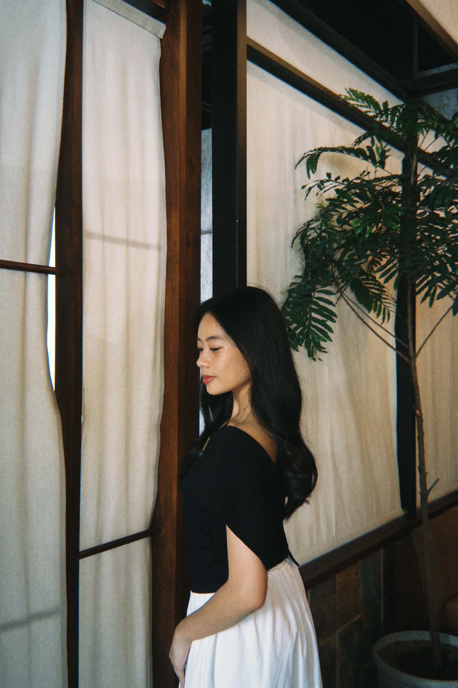

# SOFHIA ANGELA L. DY

### GE 4120 · DIGITAL PORTFOLIO

*Design · Creativity · Technology · Growth*

 

> *A collection of ideas, designs, discoveries, and digital experiences.*

---

## ✦ ABOUT ME ✦

Hi! I'm **Sofhia Angela L. Dy**, a student exploring the creative and technological world of digital design, multimedia, branding, and information technology through GE 4120.

This portfolio showcases my activities, projects, and learning experiences throughout the course. Each output represents an opportunity to experiment with ideas, discover new digital tools, develop creative skills, and understand how design and technology work together in creating meaningful digital experiences.

I believe that creativity is not simply about making things look beautiful. It is also about communicating ideas, solving problems, and creating something that people can connect with.

*Somewhere between creativity and curiosity.*

---

# THE ARCHIVE

### A JOURNEY THROUGH ACTIVITIES 01–07

*Scroll through the collection.*

---

## 🎞 ACTIVITY 01
### [Activity 1 — Presentation Design](./Activity-1/README.md)

> *The beginning of the creative process.*

This activity introduces the fundamentals of presentation design, organization of information, visual communication, and creating presentations that communicate ideas effectively.

**What you'll find:**
- Design principles
- Visual presentation techniques
- Information organization
- Creative presentation development

[↗ EXPLORE ACTIVITY 01](./Activity-1/README.md)

---

## 🎞 ACTIVITY 02
### [Activity 2 — Digital Creativity](./Activity-2/README.md)

> *Ideas transformed into digital outputs.*

This activity explores digital tools, creative processes, and the development of outputs that combine technology and creativity.

**What you'll find:**
- Digital tools and applications
- Creative experimentation
- Digital production
- Practical learning

[↗ EXPLORE ACTIVITY 02](./Activity-2/README.md)

---

## 🎞 ACTIVITY 03
### [Activity 3 — Project Documentation](./Activity-3/README.md)

> *Behind every creative output is a process.*

This activity focuses on documenting a project, organizing information, and communicating the different stages of development.

**What you'll find:**
- Project documentation
- Organization of ideas
- Planning and development
- Documentation techniques

[↗ EXPLORE ACTIVITY 03](./Activity-3/README.md)

---

## 🎞 ACTIVITY 04
### [Activity 4 — Digital Design](./Activity-4/README.md)

> *Designing with intention.*

This activity highlights the importance of creativity, design choices, visual composition, and using digital tools to produce engaging outputs.

**What you'll find:**
- Design exploration
- Visual composition
- Digital design techniques
- Creative problem-solving

[↗ EXPLORE ACTIVITY 04](./Activity-4/README.md)

---

## 🎞 ACTIVITY 05
### [Activity 5 — Multimedia and Visual Communication](./Activity-5/README.md)

> *Visuals have a language of their own.*

This activity explores how multimedia and visual elements can be used to communicate ideas, improve engagement, and deliver information creatively.

**What you'll find:**
- Visual communication
- Multimedia concepts
- Creative storytelling
- Digital content

[↗ EXPLORE ACTIVITY 05](./Activity-5/README.md)

---

## 🎞 ACTIVITY 06
### [Activity 6 — Technology and Innovation](./Activity-6/README.md)

> *Learning how technology shapes the way we create.*

This activity highlights the role of technology, digital platforms, and innovation in developing practical and creative solutions.

**What you'll find:**
- Technology exploration
- Digital innovation
- Practical applications
- Skills development

[↗ EXPLORE ACTIVITY 06](./Activity-6/README.md)

---

## 🎞 ACTIVITY 07
### [Activity 7 — Final Creative Output](./Activity-7/README.md)

> *Everything learned, brought together.*

This activity represents the culmination of the course's learning experiences, applying knowledge, creativity, and digital skills to produce a final output.

**What you'll find:**
- Application of learned concepts
- Creative development
- Digital skills
- Reflection and growth

[↗ EXPLORE ACTIVITY 07](./Activity-7/README.md)

---

---

## ✦ THE CREATIVE PROCESS ✦

**IDEA → EXPLORE → CREATE → REFINE → PRESENT**

Every activity is a reminder that learning is a continuous process of experimentation, improvement, and discovery.

---

### THANK YOU FOR VISITING MY DIGITAL PORTFOLIO

*Created with creativity, curiosity, and a little bit of blue.*

**SOFHIA ANGELA L. DY**

GE 4120 · DIGITAL PORTFOLIO

