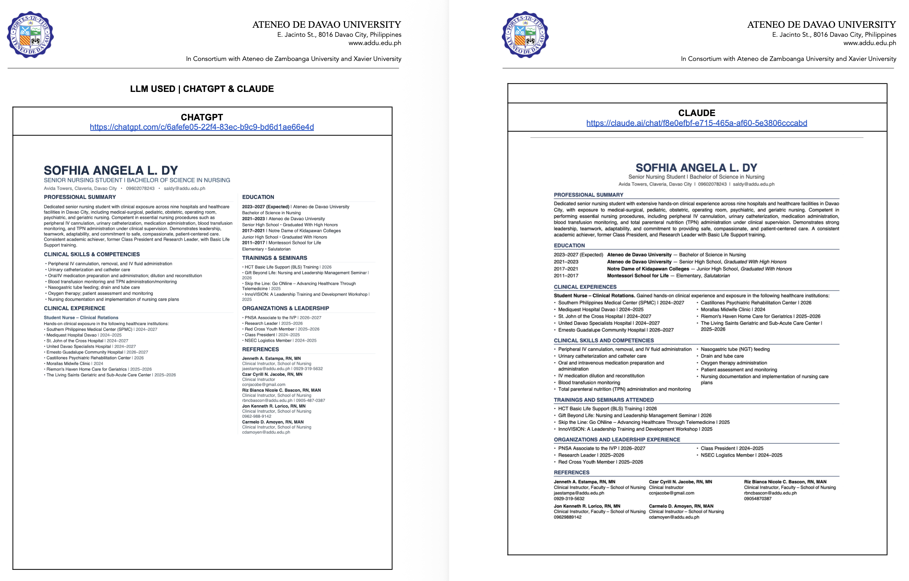

 

---

# ✦ WELCOME TO MY DIGITAL PORTFOLIO ✦

**A collection of creativity, design, digital skills, ideas, and learning experiences.**

This digital portfolio showcases my work, activities, projects, and learning experiences in **GE 4120 – 21st Century IT Skills**. Throughout the course, I explored different ways technology, creativity, communication, and digital tools can be used to create meaningful and engaging outputs.

From presentation design and branding to digital projects, documentation, and AI-assisted work, each activity represents an opportunity to develop my skills, explore ideas, and improve how I communicate visually and digitally.

---

# 🪞 ABOUT ME

Hi! I'm **Sofhia Angela L. Dy**, a student of Ateneo de Davao University.

I enjoy exploring creative ideas, learning new digital tools, and turning concepts into visually appealing and meaningful outputs. Through this portfolio, I document my growth and experiences in using technology as a tool for creativity, communication, productivity, and innovation.

I believe that technology is not only about knowing how to use tools, but also about understanding how to use them purposefully.

### ✧ A little about me

- 🎓 Student of Ateneo de Davao University
- 💻 Exploring digital technology and IT skills
- 🎨 Interested in creativity, design, branding, and visual communication
- ✨ Learning how to use digital tools more effectively
- 🧠 Open to new ideas, challenges, and learning experiences

 

---

# 📚 MY ACTIVITIES

| ACTIVITY | DESCRIPTION | OUTPUT |
|:---:|:---|:---:|
| **Activity 1** | Presentation Design Principles – promotional flyer design focusing on visual hierarchy, contrast, composition, and communication. | [View Activity](./Activity-1/README.md) |
| **Activity 2** | Color Palette & Typography – development of a personal brand identity using color, typography, and visual consistency. | [View Activity](./Activity-2/README.md) |
| **Activity 3** | Infographic & Project Documentation – visual communication of hospital waiting-time issues and the proposed MediQueue system. | [View Activity](./Activity-3/README.md) |
| **Activity 4** | Preliminary Examination – compilation and presentation of work, digital outputs, and examination-related portfolio material. | [View Activity](./Activity-4/README.md) |
| **Activity 5** | Kapeng Umaga vs. Maison Miel – comparative creative and digital design project. | [View Activity](./Activity-5/README.md) |
| **Activity 6** | Likha Leather Works – digital business, design, and creative project. | [View Activity](./Activity-6/README.md) |
| **Activity 7** | Comparative Resume Generation Using Multiple LLMs – comparison of AI-generated resumes using different AI platforms. | [View Activity](./Activity-7/README.md) |

---

# 🖼️ PORTFOLIO GALLERY

## ✦ A VISUAL LOOK AT MY WORK ✦

<table>
<tr>
<td align="center" width="50%">

### ☕ ACTIVITY 1

**Presentation Design Principles**

Promotional flyer design highlighting contrast, visual hierarchy, imagery, and layout.

[View Activity 1](./Activity-1/README.md)

</td>

<td align="center" width="50%">

### 🎨 ACTIVITY 2

**Color Palette & Typography**

Personal branding through colors, typography, logo, and design consistency.

[View Activity 2](./Activity-2/README.md)

</td>
</tr>

<tr>
<td align="center" width="50%">

### 🩺 ACTIVITY 3

**Infographic & Documentation**

Visual storytelling about hospital waiting times and the MediQueue proposal.

[View Activity 3](./Activity-3/README.md)

</td>

<td align="center" width="50%">

### 📂 ACTIVITY 4

**Preliminary Examination**

Digital portfolio work and examination-related output.

[View Activity 4](./Activity-4/README.md)

</td>
</tr>

<tr>
<td align="center" width="50%">

### 🧁 ACTIVITY 5

**Kapeng Umaga vs. Maison Miel**

Creative comparison and digital design exploration.

[View Activity 5](./Activity-5/README.md)

</td>

<td align="center" width="50%">

### 👜 ACTIVITY 6

**Likha Leather Works**

Creative business and digital project development.

[View Activity 6](./Activity-6/README.md)

</td>
</tr>

<tr>
<td align="center" width="50%">

### 🤖 ACTIVITY 7

**Comparative Resume Generation Using Multiple LLMs**

Exploring AI-generated resume outputs and evaluating their differences.

[View Activity 7](./Activity-7/README.md)

</td>

<td align="center" width="50%">

### ✨ MY DIGITAL JOURNEY

**Learning, Creating, and Exploring**

My journey in developing digital skills and creativity.

</td>
</tr>
</table>

---

# 📖 ACTIVITY DETAILS

<b>☕ ACTIVITY 1 — PRESENTATION DESIGN PRINCIPLES</b>

 

### Overview

Activity 1 focused on the application of fundamental presentation design principles through the creation of a promotional flyer for a free coffee booth at Arrupe Hall, Booth 7.

The design aimed to communicate information quickly while maintaining a visually engaging composition.

### Design Principles Applied

- **Contrast** – making important text stand out.
- **Visual Hierarchy** – prioritizing the main message and supporting details.
- **Whitespace** – allowing the design to breathe.
- **Alignment** – maintaining organization and balance.
- **Imagery** – using visual elements to support the message.
- **Typography** – selecting appropriate fonts for readability.

### Learning Experience

This activity taught me that good design is more than decoration. It is about organizing information and guiding the viewer toward the most important message.

<b>🎨 ACTIVITY 2 — COLOR PALETTE & TYPOGRAPHY</b>

 

### Overview

Activity 2 involved creating a personal brand identity using my initials, **SD**. The branding concept included a logo, business card, color palette, and typography reference.

### Brand Colors

| COLOR | HEX | MEANING |
|---|---|---|
| 🟦 Blue | `#0052C9` | Trust, professionalism, confidence |
| ⬜ Off-White | `#EEEDE9` | Simplicity, softness, modern aesthetic |

### Typography

- **Montserrat** – bold, geometric, and suitable for headings.
- **Fira Code** – clean, technical, and distinctive.

### Learning Experience

I learned how color, typography, and consistency contribute to a recognizable identity. A well-developed brand system allows different design elements to work together cohesively.

<b>🩺 ACTIVITY 3 — INFOGRAPHIC & PROJECT DOCUMENTATION</b>

 

### Overview

Activity 3 explored the use of infographics to communicate information about long hospital waiting times.

The infographic, **Waiting for Care**, highlighted the problem of delays in healthcare services and the need for more efficient patient management.

### Proposed IT Solution: MediQueue

MediQueue is a proposed digital patient queuing and scheduling system designed to improve patient flow and support efficient hospital operations.

### Proposed Features

- Online booking and scheduling
- QR-code check-in
- Patient queue monitoring
- Real-time notifications
- Centralized dashboard
- Data analytics for patient flow

### Learning Experience

This activity allowed me to understand how technology can address real-world problems. It also helped me combine research, information organization, visual design, and project documentation.

<b>📂 ACTIVITY 4 — PRELIMINARY EXAMINATION</b>

 

### Overview

This activity represents my preliminary examination work and the digital outputs developed throughout the course.

### Learning Experience

The activity allowed me to consolidate the concepts, skills, and creative approaches I had explored during the preliminary period.

<b>🧁 ACTIVITY 5 — KAPENG UMAGA VS. MAISON MIEL</b>

 

### Overview

This activity involved a creative comparison between Kapeng Umaga and Maison Miel, highlighting the role of visual presentation, creative direction, and digital design.

### Learning Experience

Through this activity, I explored how different visual approaches can influence presentation, branding, and the way audiences perceive a concept.

<b>👜 ACTIVITY 6 — LIKHA LEATHER WORKS</b>

 

### Overview

Activity 6 focused on Likha Leather Works, involving creative and digital development related to a business concept.

### Learning Experience

This activity helped me explore how digital tools and creative design can support business presentation, branding, communication, and the development of a digital concept.

<b>🤖 ACTIVITY 7 — COMPARATIVE RESUME GENERATION USING MULTIPLE LLMs</b>

 

### Overview

Activity 7 explored the use of Large Language Models in resume generation by comparing outputs from different AI platforms using the same information.

The activity examined how AI tools generate, structure, and present professional resumes.

### Comparison Focus

- Resume structure
- Organization
- Formatting
- Readability
- Professional presentation
- Content clarity
- Suitability for the intended position

### AI Tools Compared

- ChatGPT
- Claude

### Learning Experience

This activity helped me recognize that AI tools can assist with productivity and content development, but their outputs still require human evaluation, editing, and refinement.

---

# 🎨 MY BRAND IDENTITY

### Color Palette

<table>
<tr>
<td align="center">

**Blue**

`#0052C9`

</td>
<td align="center">

**Off-White**

`#EEEDE9`

</td>
</tr>
</table>

### Typography

| FONT | PURPOSE |
|---|---|
| Montserrat | Headings and emphasis |
| Fira Code | Technical and supporting text |

---

# 🛠️ TOOLS & DIGITAL SKILLS

### Skills Developed

- Digital communication
- Presentation design
- Visual organization
- Creative thinking
- Branding fundamentals
- Information presentation
- AI-assisted content development
- Project documentation
- Digital portfolio management
- GitHub and Markdown

---

# 🌱 REFLECTION

Throughout GE 4120, I discovered how digital tools can be used not only to complete academic requirements but also to express creativity, organize ideas, and solve problems.

Each activity introduced a different opportunity to explore design, technology, communication, and innovation. I learned that digital skills require continuous practice, creativity, and adaptability.

This portfolio represents more than a collection of outputs. It reflects my learning process, my willingness to explore unfamiliar tools, and my development as a student in an increasingly digital world.

I look forward to continuing to develop my skills and applying what I have learned to future academic and personal projects.

---

## ✦ DRIVEN · STRIVIN · LIVIN · THRIVIN ✦

*Creativity is not just what you make. It is how you think, communicate, and transform ideas into something meaningful.*

---

**GE 4120 | 21st Century IT Skills**

Ateneo de Davao University

© 2026 Sofhia Angela L. Dy · Digital Portfolio

