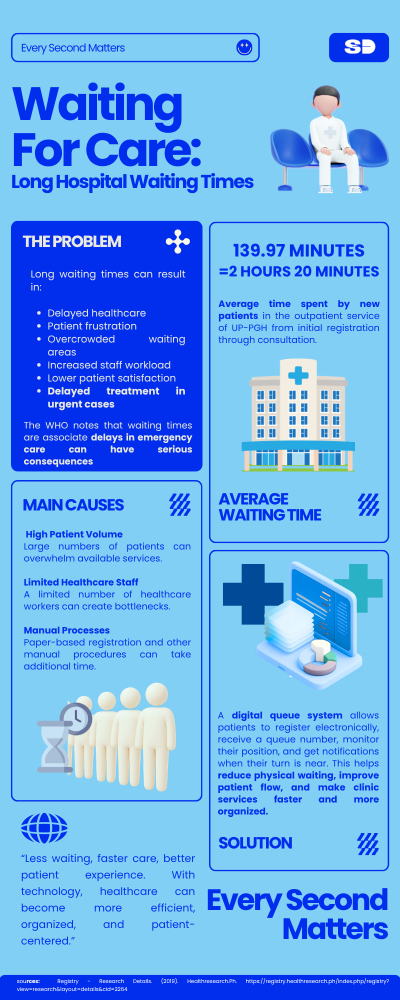
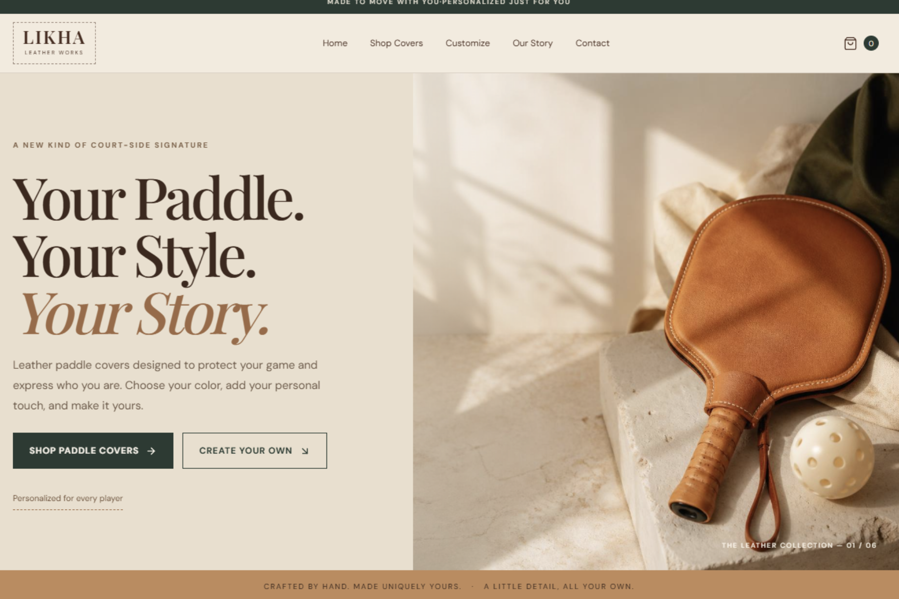
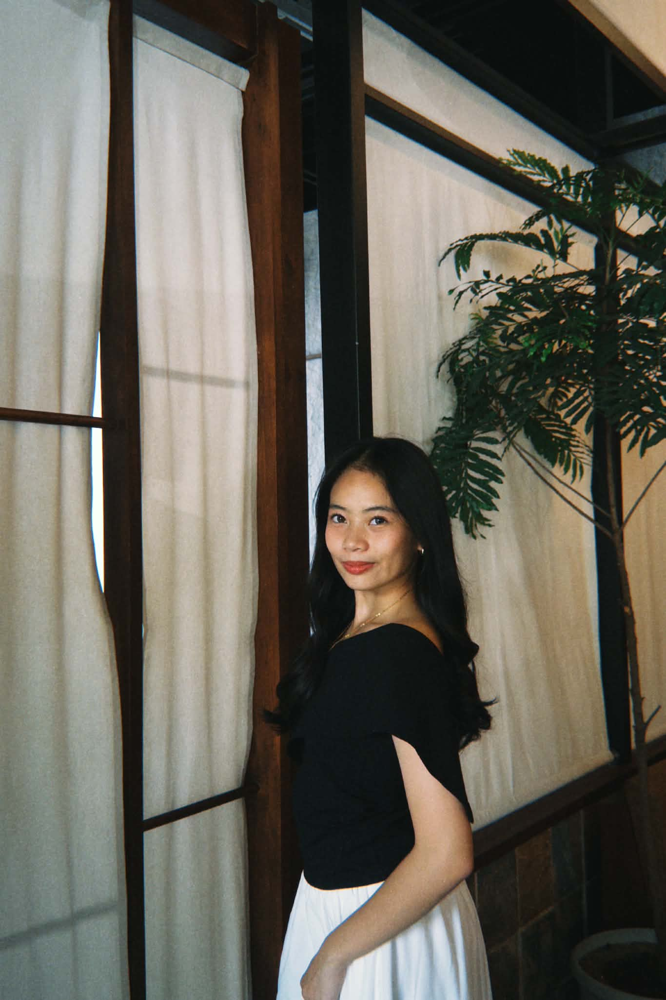

  

 

[**About**](#-about-me) &nbsp;·&nbsp; [**Activities**](#-my-activities) &nbsp;·&nbsp; [**Gallery**](#️-portfolio-gallery) &nbsp;·&nbsp; [**Details**](#-activity-details) &nbsp;·&nbsp; [**Brand**](#-my-brand-identity) &nbsp;·&nbsp; [**Skills**](#️-tools--digital-skills) &nbsp;·&nbsp; [**Reflection**](#-reflection)

---

# ✦ WELCOME TO MY DIGITAL PORTFOLIO ✦

**A collection of creativity, design, digital skills, ideas, and learning experiences.**

This digital portfolio showcases my work, activities, projects, and learning experiences in **GE 4120 – 21st Century IT Skills**. Throughout the course, I explored how technology, creativity, communication, and digital tools can come together to create meaningful and engaging outputs.

From presentation design and branding to digital projects, documentation, and AI-assisted work, each activity was an opportunity to sharpen my skills, explore ideas, and improve how I communicate visually and digitally.

---

# 🪞 ABOUT ME

Hi! I'm **Sofhia Angela L. Dy**, a Nursing student of Ateneo de Davao University (BSN 4F).

I enjoy exploring creative ideas, learning new digital tools, and turning concepts into visually appealing and meaningful outputs. This portfolio documents my growth in using technology for creativity, communication, productivity, and innovation.

> *Technology is not only about knowing how to use tools. It is about understanding how to use them with purpose.*

### ✧ A little about me

- 🎓 Student of Ateneo de Davao University
- 💻 Exploring digital technology and IT skills
- 🎨 Interested in creativity, design, branding, and visual communication
- ✨ Learning how to use digital tools more effectively
- 🧠 Open to new ideas, challenges, and learning experiences

 

---

# 📚 MY ACTIVITIES

| # | ACTIVITY | DESCRIPTION | OUTPUT |
|:---:|:---|:---|:---:|
| **1** | ☕ **Presentation Design Principles** | Promotional flyer design focusing on visual hierarchy, contrast, composition, and communication. | [View →](./Activity-1/README.md) |
| **2** | 🎨 **Color Palette & Typography** | Development of a personal brand identity using color, typography, and visual consistency. | [View →](./Activity-2/README.md) |
| **3** | 🩺 **Infographic & Project Documentation** | Visual communication of hospital waiting-time issues and the proposed MediQueue system. | [View →](./Activity-3/README.md) |
| **4** | 📂 **Preliminary Examination** | Compilation and presentation of work, digital outputs, and examination-related portfolio material. | [View →](./Activity-4/README.md) |
| **5** | 🧁 **Kapeng Umaga vs. Maison Miel** | Comparative creative and digital design project. | [View →](./Activity-5/README.md) |
| **6** | 👜 **Likha Leather Works** | Digital business, design, and creative project. | [View →](./Activity-6/README.md) |
| **7** | 🤖 **Comparative Resume Generation Using Multiple LLMs** | Comparison of AI-generated resumes using different AI platforms. | [View →](./Activity-7/README.md) |

---

# 🖼️ PORTFOLIO GALLERY

## ✦ A VISUAL LOOK AT MY WORK ✦

<table>
<tr>
<td align="center" width="50%">

### ☕ ACTIVITY 1

**Presentation Design Principles**

Promotional flyer highlighting contrast, visual hierarchy, imagery, and layout.

[View Activity 1 →](./Activity-1/README.md)

</td>

<td align="center" width="50%">

### 🎨 ACTIVITY 2

**Color Palette & Typography**

Personal branding through color, typography, logo, and design consistency.

[View Activity 2 →](./Activity-2/README.md)

</td>
</tr>

<tr>
<td align="center" width="50%">

### 🩺 ACTIVITY 3

**Infographic & Documentation**

Visual storytelling about hospital waiting times and the MediQueue proposal.

[View Activity 3 →](./Activity-3/README.md)

</td>

<td align="center" width="50%">

### 📂 ACTIVITY 4

**Preliminary Examination**

Digital portfolio work and examination-related output.

[View Activity 4 →](./Activity-4/README.md)

</td>
</tr>

<tr>
<td align="center" width="50%">

### 🧁 ACTIVITY 5

**Kapeng Umaga vs. Maison Miel**

Creative comparison and digital design exploration.

[View Activity 5 →](./Activity-5/README.md)

</td>

<td align="center" width="50%">

### 👜 ACTIVITY 6

**Likha Leather Works**

Creative business and digital project development.

[View Activity 6 →](./Activity-6/README.md)

</td>
</tr>

<tr>
<td align="center" width="50%">

### 🤖 ACTIVITY 7

**Comparative Resume Generation Using Multiple LLMs**

Exploring AI-generated resume outputs and evaluating their differences.

[View Activity 7 →](./Activity-7/README.md)

</td>

<td align="center" width="50%">

### ✨ MY DIGITAL JOURNEY

**Learning, Creating, and Exploring**

My journey in developing digital skills and creativity.

</td>
</tr>
</table>

---

# 📖 ACTIVITY DETAILS

> 💡 Click any activity to expand it.

<b>☕ ACTIVITY 1 — PRESENTATION DESIGN PRINCIPLES</b>

 

### Overview

Activity 1 applied fundamental presentation design principles through a promotional flyer for a free coffee booth at **Arrupe Hall, Booth 7**. The design aimed to communicate information quickly while staying visually engaging.

### Design Principles Applied

| Principle | How it was used |
|:---|:---|
| **Contrast** | Making important text stand out from the background |
| **Visual Hierarchy** | Prioritizing the main message over supporting details |
| **Whitespace** | Giving the layout room to breathe |
| **Alignment** | Keeping the composition organized and balanced |
| **Imagery** | Using visuals to reinforce the message |
| **Typography** | Choosing fonts for readability and tone |

### Learning Experience

Good design is more than decoration. It is about organizing information and guiding the viewer toward the most important message.

[⬆ Back to top](#)

<b>🎨 ACTIVITY 2 — COLOR PALETTE & TYPOGRAPHY</b>

 

### Overview

Activity 2 involved creating a personal brand identity using my initials, **SD**. The branding concept included a logo, business card, color palette, and typography reference.

### Brand Colors

| COLOR | HEX | MEANING |
|---|---|---|
| 🟦 Blue | `#0052C9` | Trust, professionalism, confidence |
| ⬜ Off-White | `#EEEDE9` | Simplicity, softness, modern aesthetic |

### Typography

- **Montserrat** – bold, geometric, suited for headings.
- **Fira Code** – clean, technical, and distinctive.

### Learning Experience

Color, typography, and consistency work together to create a recognizable identity. A well-built brand system lets different design elements feel cohesive.

[⬆ Back to top](#)

<b>🩺 ACTIVITY 3 — INFOGRAPHIC & PROJECT DOCUMENTATION</b>

 

### Overview

Activity 3 explored infographics as a way to communicate the problem of long hospital waiting times. The infographic, **Waiting for Care**, highlights delays in healthcare services and the need for more efficient patient management.

### Proposed IT Solution: MediQueue

MediQueue is a proposed digital patient queuing and scheduling system designed to improve patient flow and support efficient hospital operations.

### Proposed Features

- 📅 Online booking and scheduling
- 📱 QR-code check-in
- 👀 Patient queue monitoring
- 🔔 Real-time notifications
- 🖥️ Centralized dashboard
- 📊 Data analytics for patient flow

### Learning Experience

This activity showed me how technology can address real-world problems, and it combined research, information organization, visual design, and project documentation.

[⬆ Back to top](#)

<b>📂 ACTIVITY 4 — PRELIMINARY EXAMINATION</b>

 

### Overview

This activity represents my preliminary examination work and the digital outputs developed throughout the course.

### Learning Experience

It allowed me to consolidate the concepts, skills, and creative approaches I explored during the preliminary period.

[⬆ Back to top](#)

<b>🧁 ACTIVITY 5 — KAPENG UMAGA VS. MAISON MIEL</b>

 

### Overview

A creative comparison between Kapeng Umaga and Maison Miel, highlighting the role of visual presentation, creative direction, and digital design.

### Learning Experience

I explored how different visual approaches influence presentation, branding, and the way audiences perceive a concept.

[⬆ Back to top](#)

<b>👜 ACTIVITY 6 — LIKHA LEATHER WORKS</b>

 

### Overview

Activity 6 focused on Likha Leather Works, involving creative and digital development of a business concept.

### Learning Experience

Digital tools and creative design can support business presentation, branding, communication, and the development of a digital concept.

[⬆ Back to top](#)

<b>🤖 ACTIVITY 7 — COMPARATIVE RESUME GENERATION USING MULTIPLE LLMs</b>

 

### Overview

Activity 7 compared resumes generated by different AI platforms from the same information, examining how each tool generates, structures, and presents a professional resume.

### Comparison Focus

| Criteria | What was evaluated |
|:---|:---|
| Structure & Organization | How sections are arranged and prioritized |
| Formatting | Layout consistency and visual polish |
| Readability | Ease of scanning and reading |
| Content Clarity | Accuracy and precision of wording |
| Professional Presentation | Overall impression and credibility |
| Suitability | Fit for the intended position |

### AI Tools Compared

- ChatGPT
- Claude

### Learning Experience

AI tools can assist with productivity and content development, but their outputs still need human evaluation, editing, and refinement.

[⬆ Back to top](#)

---

# 🎨 MY BRAND IDENTITY

  

### Color Palette

<table>
<tr>
<td align="center">

**Blue**

`#0052C9`

</td>
<td align="center">

**Off-White**

`#EEEDE9`

</td>
</tr>
</table>

### Typography

| FONT | PURPOSE |
|---|---|
| **Montserrat** | Headings and emphasis |
| **Fira Code** | Technical and supporting text |

---

# 🛠️ TOOLS & DIGITAL SKILLS

### Skills Developed

| Area | Skills |
|:---|:---|
| **Design** | Presentation design · Visual organization · Branding fundamentals · Typography |
| **Communication** | Digital communication · Information presentation · Infographics |
| **Technology** | AI-assisted content development · GitHub and Markdown · Digital portfolio management |
| **Mindset** | Creative thinking · Project documentation · Adaptability |

---

# 🌱 REFLECTION

Throughout GE 4120, I discovered how digital tools can be used not only to complete academic requirements but also to express creativity, organize ideas, and solve problems.

Each activity introduced a different opportunity to explore design, technology, communication, and innovation. I learned that digital skills require continuous practice, creativity, and adaptability.

This portfolio represents more than a collection of outputs. It reflects my learning process, my willingness to explore unfamiliar tools, and my development as a student in an increasingly digital world.

I look forward to applying what I have learned to future academic and personal projects.

---

## ✦ DRIVEN · STRIVIN · LIVIN · THRIVIN ✦

*Creativity is not just what you make. It is how you think, communicate, and transform ideas into something meaningful.*

---

**GE 4120 | 21st Century IT Skills**

Ateneo de Davao University

© 2026 Sofhia Angela L. Dy · Digital Portfolio

